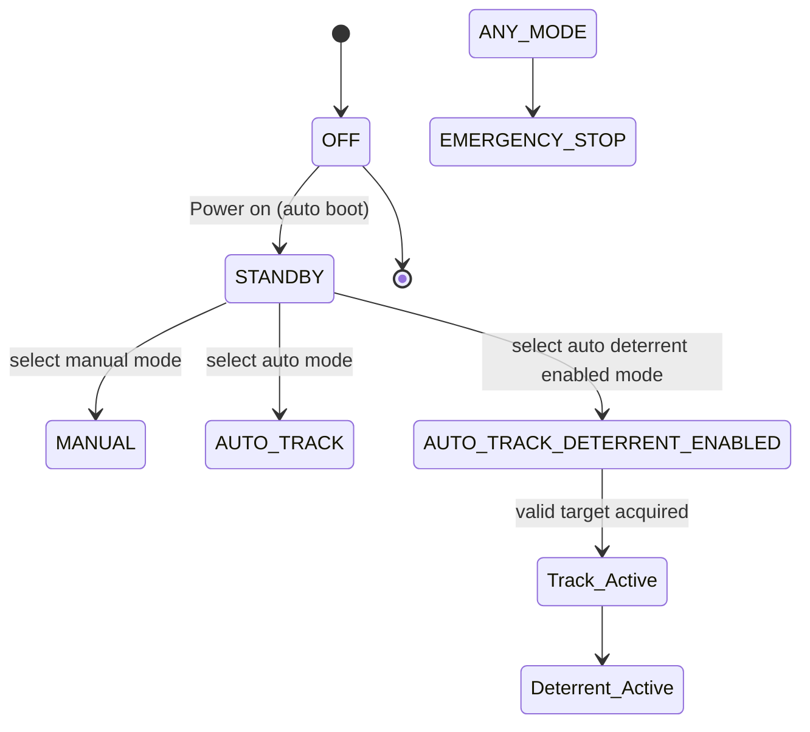
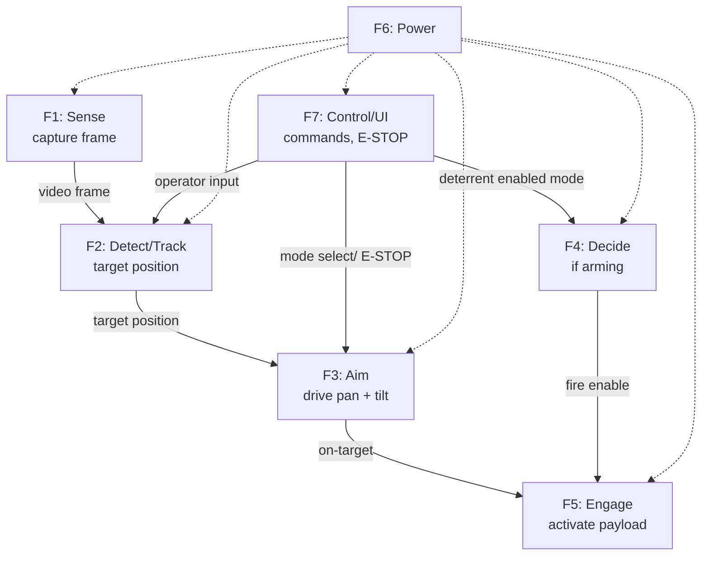

# "OhPossum" Systems Engineering 
# Master Document 
## Executive Summary 
This document consolidates all systems engineering work pertaining to project "OhPossum", a pan-tilt turret.
The engineering is staged: single axis (pan-only) prototype is to be built and tested first to de-risk interfaces and build team experience and knowledge - this will be termed stage 1 (STG-1). 
The second axis (tilt) will then take the learnings from the first stage, and apply them in order to complete the dual axis turret - this will be termed stage 2 (STG-2). 
Finally, deterrent functionality will be added to the system - this will be termed stage 3 (STG-3). 

### Current Project Stage = Stage 1

## Acronyms
| Acronym | Text |
| --- | --- |
|ASS|Assumption|
|CT|Constraint|
|DE|Dependencies|
|FR|Functional Requirement|
| ICD | Interface Control Document |
| ID | Identification |
|ItR|Interface Requirement|
|PrR|Performance Requirement|
|PSU | Power Supply Unit|
|RL|Reliability Requirement|
| SDD | System Design Document |
|SR|Safety Requirement|
|STG|Stage (in development)|
| SyRS | System Requirement Specification |
| UC | Use Case |
| UI | User Interface |
## Concept of Operations (ConOps)
### Use Cases
|Use Case ID| Use Case | Summary | 
| --- | ---| --- |
| UC-1 | Single axis bench test | Prove the mechanical, electrical and software interfaces|
| UC-2 | Pan/tilt axis bench test | Prove mechanical, electrical and software interfaces for both axis prior to full implementation
| UC-3| Manual operation | Operator uses manual inputs to control pan/tilt axis from a User Interface (UI)|
| UC-4 | Deterrent | Automatically track and identify, using a water stream to deter the target
### Operating Environments
|Environment| Conditions | Notes | 
| --- | ---| --- |
|Bench test/development| 5-40 degrees celsius, located on a desk, powered by a bench PSU | For single and dual axis bench test (UC-1 & UC-2)
|Outside - under cover | 5-40 degrees celsius, outdoor humidity, no rain on electronics |  
### Operational Modes
|Mode|Description|Entry/Exit|
|---|---|---|
|OFF|Unpowered|Power turned off/power turned on|
|STANDBY|Powered, homing functions have been performed, deterrent system disabled| Enters mode directly after power on / exits upon selection of any other state 
|MANUAL|Operator drives pan/tilt and enables/disables deterrent | User selects manual mode / exits upon selection of any other state
|AUTO-TRACK|Detects and follows a target, deterrent disabled | User selects AUTO-TRACK mode / exits upon selection of another state 
|AUTO-TRACK DETERRENT ENABLED|Detects and follows a target, when a valid target is locked, deterrent is enabled|User selects AUTO-TRACK DETERRENT ENABLED mode / exits upon selection of any other state
|EMERGENCY STOP|Emergency stop breaks motor & deterrent circuits, stopping motor motion and disabling deterrent |User enables emergency stop/user disables emergency stop and begins TBD restart process
### Support & Maintenance Needs
- Consumables:
    - Refill water reservoir 
    - Battery charging (TBD - not included in UC-1 or UC-2 but may be introduced in UC-3/4)
- Diagnostics:
    - Session log - TBD
    - Status lights - TBD
- Wear items:
    - 3D printed items can be easily printed, or upgraded to machined metal parts at a later date
    - Motors - the loads and speeds are well within safe limits - therefore wear should be slowed
- Design modularity:
    - Ability to switch deterrent - TBD
    - Ability to add another axis. Or ability to move in translation - TBD
## System Requirements Specification (SyRS)
**Note**
- T = Test
- D = Demonstration 
- I = Inspection 
- A = Analysis
### Functional Requirements
What the system must do.
|ID|Requirement|Verification Method|
|---|---|---|
|FR-01|The turret shall detect a target of size >0.1m^2 but <1.0m^2 within range specified in PR-01|Test
|FR-02| The turret camera shall acquire a video stream of the forward field of view| Demonstrate
|FR-03|The turret shall move in pan and tilt axis |
|FR-04||
|FR-05||
|FR-06||
|FR-07||
|FR-08||
|FR-09||
|FR-10||

### Non-Functional Requirements
Performance, reliability, safety. 
|ID|Requirement|Verification Method|
|---|---|---|
|PrR-01|The turret shall perform all 
|PrR-02|
|PrR-03|The turret shall rotate about the pan axis at a speed of TBD rad/s
|PrR-04|The turret shall rotate about the tilt axis at a speed of TBD rad/s
|PrR-05|
|PrR-06|

|ID|Requirement|Verification Method|
|---|---|---|
|RL-01|
|RL-01|
|RL-01|
|RL-01|
|RL-01|

|ID|Requirement|Verification Method|
|---|---|---|
|SR-01| 
|SR-01| 
|SR-01| 
|SR-01| 

### Interfaces 
External systems, users, hardware 
|ID|Requirement|Verification Method|
|---|---|---|
|ItR-01|
|ItR-01|
|ItR-01|
|ItR-01|

### Constraints
Regulatory, environmental 
|ID|Requirement|Verification Method|
|---|---|---|
|CT-01|

### Assumptions & Dependencies
|ID|Requirement|Verification Method|
|---|---|---|
|ASS-01|

|ID|Requirement|Verification Method|
|---|---|---|
|DE-01|

## System Architecture
### State Diagram - TODO

### Functional Decomposition
What functions the system performs.

### System Breakdown
#### Mechanical/electrical/software

### Physical Block Diagram

## Interface Control Document (ICD)
### Mechanical Interfaces
Mounts etc. 
### Electrical Interfaces
Power rails, signal lines.
### Data/Comms Interfaces
Protocols.
Camera via USB to Raspberry Pi? Ethernet (I can't remember lol)
### Human/Machine Interfaces
Controls/e-stop etc. 

## System Design Document (SDD)
### Pan-Axis Design 

#### Design Trade-Offs

### Tilt-Axis Design 

#### Design Trade-Offs

## Hardware Component Selection

## Verification & Validation Plan
Verification runs in 3 staged efforts to match the build strategy: stage 1 verifies the pan-axis (single-axis) prototype, stage 2 verifies the dual axis prototype, stage 3 verifies the dual axis prototype with deterrent functionality. Methods are Test, Demonstration, Inspection and Analysis. 
### Test Cases & Scenarios
#### Test Environments 
|ID|Environment|Setup|
|---|---|---|
|TE-1|Bench (single axis)|Desktop, bench PSU, manually commanded position|
|TE-2|Bench (dual axis)|Desktop, bench PSU, moving or fixed target, automatic tracking|
|TE-3|Analysis/Simulation/CAD|Torque/stress and thermal checks for analysis-verified items|
|TE-4|Outdoors|Covered area, water resovoir, splash-safe layout|
#### Stage 1 - Pan-Axis (Single-Axis) Test Cases
|Test|Verifies|Acceptance Criteria|Environment|
|---|---|---|---|
|||||
#### Stage 2 - Dual-Axis (Pan & Tilt) Test Cases
|Test|Verifies|Acceptance Criteria|Environment|
|---|---|---|---|

#### Stage 3 - Dual-Axis, Deterrent Enabled Test Cases
|Test|Verifies|Acceptance Criteria|Environment|
|---|---|---|---|

## Risk Register
### Risks/Likelihood/Impact/Mitigation
|ID|Risk|Impact|Mitigation
|---|---|---|---|
|RK-1|Can't pass USB through slip ring|||
|RK-2|Can't pass ethernet through slip ring|||
|RK-3|Servo overheats/stalls from continuous tracking|||
|RK-4|Water contacts live electronics|||
|RK-5|False target triggers unwanted fire|||
|RK-6|Loss of target tracking|||
|RK-8|Turret tips over during extreme or quick sweeps|||
|RK-9|3D printed gears fail|||
|RK-10|Software hangs but leaves system active (motors & deterrent)|||
|RK-11|Electrical engineering failure due to lack of discipline knowledge|||
