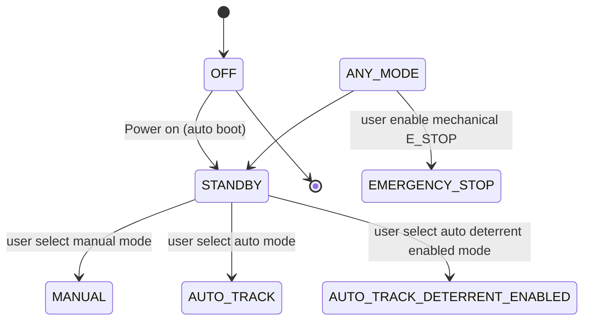
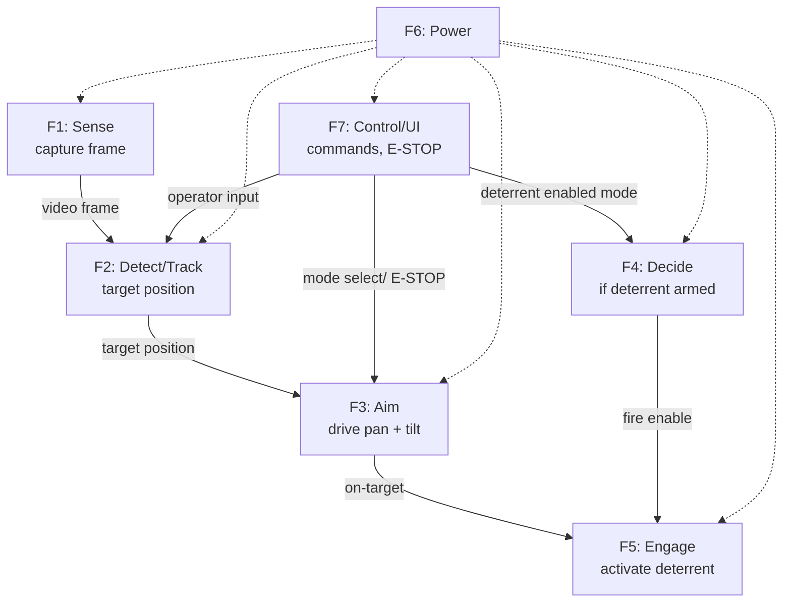

# "OhPossum" Systems Engineering 
# Master Document 
## Executive Summary 
This document consolidates all systems engineering work pertaining to project "OhPossum", a pan-tilt turret.
The engineering is staged: single axis (pan-only) prototype is to be built and tested first to de-risk interfaces and build team experience and knowledge - this will be termed stage 1 (STG-1). 
The second axis (tilt) will then take the learnings from the first stage, and apply them in order to complete the dual axis turret - this will be termed stage 2 (STG-2). 
Finally, deterrent functionality will be added to the system - this will be termed stage 3 (STG-3). 

## System Boundaries
"The System" = Anything that is required to perform functionality described in stage 3

"The Turret" = A system underneath "The System" - the pan and tilt axis implementation 

"The Deterrent" = A system underneath "The System" - includes the physical items required in The Deterrent implementation

## Acronyms
| Acronym | Text |
| --- | --- |
|ASS|Assumption|
|BOM|Bill Of Materials|
|COTS|Commercial Off The Shelf|
|CT|Constraint|
|DE|Dependencies|
|FR|Functional Requirement|
|HMI|Human Machine Interface|
| ICD | Interface Control Document |
| ID | Identification |
|ItR|Interface Requirement|
|PrR|Performance Requirement|
|PSU | Power Supply Unit|
|RL|Reliability Requirement|
| SDD | System Design Document |
|SR|Safety Requirement|
|STG|Stage (in development)|
| SyRS | System Requirement Specification |
| UC | Use Case |
| UI | User Interface |
## Concept of Operations (ConOps)
### Use Cases
|Use Case ID| Use Case | Summary | 
| --- | ---| --- |
| UC-1 | Single axis bench test | Prove the mechanical, electrical and software interfaces|
| UC-2 | Pan/tilt axis bench test | Prove mechanical, electrical and software interfaces for both axis prior to full implementation
| UC-3| Manual operation | Operator uses manual inputs to control pan/tilt axis from a User Interface (UI)|
| UC-4 | Deterrent | Automatically track and identify, using a water stream to deter the target
### Operating Environments
|Environment| Conditions | Notes | 
| --- | ---| --- |
|Bench test/development| 5-40 degrees celsius, located on a desk, powered by a bench PSU | For single and dual axis bench test (UC-1 & UC-2)
|Outside - under cover | 5-40 degrees celsius, outdoor humidity, no rain on electronics |  
### Operational Modes
|Mode|Description|Entry/Exit|
|---|---|---|
|OFF|Unpowered|Power turned off/power turned on|
|STANDBY|Powered, homing functions have been performed, deterrent system disabled| Enters mode directly after power on / exits upon selection of any other state 
|MANUAL|Operator drives pan/tilt and enables/disables deterrent | User selects manual mode / exits upon selection of any other state
|AUTO-TRACK|Detects and follows a target, deterrent disabled | User selects AUTO-TRACK mode / exits upon selection of another state 
|AUTO-TRACK DETERRENT ENABLED|Detects and follows a target, when a valid target is locked, deterrent is enabled|User selects AUTO-TRACK DETERRENT ENABLED mode / exits upon selection of any other state
|EMERGENCY STOP|Emergency stop breaks motor & deterrent circuits, stopping motor motion and disabling deterrent |User enables emergency stop/user disables emergency stop and begins TBD restart process
### Support & Maintenance Needs
- Consumables:
    - Refill water reservoir 
    - Battery charging (TBD - not included in UC-1 or UC-2 but may be introduced in UC-3/4)
- Diagnostics:
    - Session log - TBD
    - Status lights - TBD
- Wear items:
    - 3D printed items can be easily printed, or upgraded to machined metal parts at a later date
    - Motors - the loads and speeds are well within safe limits - therefore wear should be slowed
- Design modularity:
    - Ability to switch deterrent - TBD
    - Ability to add another axis. Or ability to move in translation - TBD
## System Requirements Specification (SyRS) 
# TODO: confirm all TBDs & complete TODOs
**Note**
- T = Test - record quantitative data to very performance against pass/fail criteria
- D = Demonstration - operate described system in specified environment to visually observe functionality/behaviour 
- I = Inspection - examine hardware, software or documentation to confirm compliance, doesn't require operation of the system
- A = Analysis - uses mathematical models, simulations, calculations to predict behaviour and verify requirements 

### Functional Requirements
What The System must do.
|ID|Requirement|Verification Method|Stage|
|---|---|---|---|
|FR-01|The Turret shall detect a target of size >0.1m^2 but <1.0m^2 within range specified in PR-01|T|STG-2
|FR-02| The Turret camera shall acquire a video stream of a forward field of view large enough to satisfy FR-01|D|STG-2
|FR-03|The Turret shall rotate the pan axis to a commanded angle +/- TBD degree of accuracy|T|STG-1|
|FR-04|The Turret shall rotate the tilt axis to a commanded angle  +/- TBD degree of accuracy|T|STG-2|
|FR-05|The HMI shall provide manual positional control of pan axis position|D|STG-1|
|FR-06|The HMI shall provide manual positional control of tilt axis position|D|STG-2|
|FR-07|The System shall enter the EMERGENCY-STOP state within 200ms of the E-STOP being triggered by a user|T|All 
|FR-08|When in the AUTO-TRACK DETERRENT ENABLED mode The System shall activate The Deterrent only when a valid target is acquired|T|STG-2
|FR-09|The HMI shall provide manual control of The Deterrent, specifically the ability to disable or enable The Deterrent|D|STG-2|
|FR-10|When in the AUTO-TRACK or AUTO-TRACK DETERRENT ENABLED mode The Turret shall automatically rotate the pan and tilt axis to self-calculated angles|D|STG-2

### Non-Functional Requirements
Performance, reliability, safety. 
|ID|Requirement|Verification Method|Stage|
|---|---|---|---|
|PrR-01|The Turret tracking loop shall update at >=TBD Hz|T|All|
|PrR-02|The Turret shall be able track a target moving >=TBD m/s in the pan axis|T|STG-1|
|PrR-03|The Turret shall be able track a target moving >=TBD m/s in the tilt axis|T|STG-2|
|PrR-04|The Turret shall rotate about the pan axis at a speed of TBD rad/s|T|STG-1|
|PrR-05|The Turret shall rotate about the tilt axis at a speed of TBD rad/s|T|STG-2|
|PrR-06|The Turret shall have a pan axis range of >=180 degrees|T|STG-1|
|PrR-07|The Turret shall have a tilt axis range of >=90 degrees|T|STG-2|
|PrR-08|The System shall have an effective operating range >=0.5m and <=3m|T|STG-3|
|PrR-09|The System shall have an aim error <=+/-3 degrees when actively tracking a valid target moving at the speeds specified in PrR-02 & PrR-03|T|STG-3|

|ID|Requirement|Verification Method|Stage|
|---|---|---|---|
|RL-01|The System shall operate continuously for >=10 minutes without any loss of functionality|D|All|
|RL-02|The System shall keep all electrical components described in TBD BOM within duty and thermal limits during continuous operation duration described in RL-01|T|All|
|RL-03|On target loss >2 seconds, The Turret shall return to a pre-defined home/search state (TBD) without oscillation|D|STG-2&3|
|RL-04|During a power interruption, The System shall transition current mode to STANDBY mode without manual reconfiguration|D|All|

|ID|Requirement|Verification Method|Stage|
|---|---|---|---|
|SR-01|The E-STOP is a hardware cutoff of actuators and deterrent, independent of software|D|All|
|SR-02|When a water deterrent is equipped, electronics described in TBD BOM shall be rated to >=IP54 or housed in enclosures rated to >=IP54|I|STG-3|
|SR-03|The System shall power up in STANDBY with The Deterrent disabled (fail-safe default)|D|All|
|SR-04|The System shall have no pinch points accessible that permit objects >=12mm|I|All|

### Interface Requirements
External systems, users, hardware 
|ID|Requirement|Verification Method|Stage|
|---|---|---|---|
|ItR-01|All actuators shall accept TBD Hz PWM signals|I|All|
|ItR-02|The Deterrent must attach to Stage 1&2 implementation|D|STG-3
|ItR-03|The operator UI must connect over TBD protocol (USB, Ethernet)|D|STG-1|

### Constraints
Regulatory, environmental 
|ID|Constraint|Enforced By|Stage|
|---|---|---|---|
|CT-01|Power implementation shall be compatible with water based deterrent|SR-02|STG-3|
|CT-02|Electrical noise must not cause compute resets or dropouts|CT-02|All|
|CT-03|Operating temperature >=5 degrees celsius and <=40 degrees celsius|CT-03|All|
|CT-04|Electronics in TBD BOM shall be rated to >=IP54|SR-02|STG-3|
|CT-05|Where custom parts are necessary The System must be largely buildable on the Bambu Labs X1C 3D printer (256mm^3), printing in segments is possible|CT-05|All|
|CT-06|The System shall use off the shelf parts where possible - noting custom PCB or manufacturing outside of methods described in CT-05 may be possible|CT-06|All|

### Assumptions & Dependencies
|ID|Assumption|Stage|
|---|---|---|
|ASS-01|Ambient lighting is adeqaute for camera detection|STG-2|
|ASS-02|A single target of interest is present at a time|STG-2&3|
|ASS-03|An operator is present to arm and E-STOP when deterrent is enabled|STG-3|
|ASS-04|The System is placed on a level, stable surface|All|

|ID|Dependency|Stage|
|---|---|---|
|DE-01|Selected COTS parts are obtainable|All|
|DE-02|A reliable power supply is available for The System|All|

## System Architecture
### State Diagram

### Functional Decomposition
What functions The System performs.

### System Breakdown
#### Mechanical/electrical/software

### Physical Block Diagram

## Interface Control Document (ICD)
### Mechanical Interfaces
Mounts etc. 
### Electrical Interfaces (TODO: SASHA)
Power rails, signal lines.
### Data/Comms Interfaces (TODO: SASHA)
Protocols.
Camera via USB to Raspberry Pi? Ethernet (I can't remember lol)
### Human/Machine Interfaces (TODO: SASHA)
Controls/e-stop etc. 

## System Design Document (SDD)
### Pan-Axis Design 

#### Design Trade-Offs

### Tilt-Axis Design 

#### Design Trade-Offs

## Hardware Component Selection

## Verification & Validation Plan
Verification runs in 3 staged efforts to match the build strategy: stage 1 verifies the pan-axis (single-axis) prototype, stage 2 verifies the dual axis prototype, stage 3 verifies the dual axis prototype with deterrent functionality. Methods are Test, Demonstration, Inspection and Analysis. 
### Test Cases & Scenarios
#### Test Environments 
|ID|Environment|Setup|
|---|---|---|
|TE-1|Bench (single axis)|Desktop, bench PSU, manually commanded position|
|TE-2|Bench (dual axis)|Desktop, bench PSU, moving or fixed target, automatic tracking|
|TE-3|Analysis/Simulation/CAD|Torque/stress and thermal checks for analysis-verified items|
|TE-4|Outdoors|Covered area, water resovoir, splash-safe layout|
#### Test Cases Affecting All Stages 
|Test|Verifies|Acceptance Criteria|Environment|
|---|---|---|---|
|TC-ALL-01|||
#### Stage 1 - Pan-Axis (Single-Axis) Test Cases
|Test|Verifies|Acceptance Criteria|Environment|
|---|---|---|---|
|TC-STG1-01||||
|TC-STG1-02||||
|TC-STG1-03||||
|TC-STG1-04||||
|TC-STG1-05||||
|TC-STG1-06||||
|TC-STG1-07||||
|TC-STG1-08||||

#### Stage 2 - Dual-Axis (Pan & Tilt) Test Cases
|Test|Verifies|Acceptance Criteria|Environment|
|---|---|---|---|
|TC-STG2-01||||
|TC-STG2-02||||
|TC-STG2-03||||
|TC-STG2-04||||
|TC-STG2-05||||
|TC-STG2-06||||
|TC-STG2-07||||
|TC-STG2-08||||

#### Stage 3 - Dual-Axis, Deterrent Enabled Test Cases
|Test|Verifies|Acceptance Criteria|Environment|
|---|---|---|---|
|TC-STG3-01||||
|TC-STG3-02||||
|TC-STG3-03||||
|TC-STG3-04||||
|TC-STG3-05||||
|TC-STG3-06||||
|TC-STG3-07||||
|TC-STG3-08||||

## Risk Register
### Risks/Likelihood/Impact/Mitigation
|ID|Risk|Likelihood|Impact|Mitigation|Stage|
|---|---|---|---|---|---|
|RK-1|Data corruption & noise when transmitting USB through slip ring||||STG-1&2|
|RK-2|Data corruption & noise when transmitting ethernet through slip ring||||STG-1&2|
|RK-3|Motor overheats/stalls from continuous tracking||||All|
|RK-4|Water contacts live electronics||||STG-3|
|RK-5|False target triggers unwanted fire||||STG-3|
|RK-6|Loss of target tracking||||STG-2|
|RK-8|Turret tips over during extreme or quick sweeps||||
|RK-9|3D printed gears fail||||
|RK-10|Software hangs but leaves system active (motors & deterrent)||||
|RK-11|Electrical engineering failure due to lack of discipline knowledge||||
|RK-12|Difficulty/inability to update firmware due to physical access||||
|RK-13|Electrical component failure, and lack of modularity/ability to easily replace||||All|
